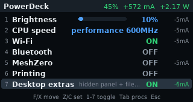
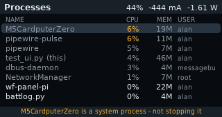

# PowerDeck

Quick power switches for the M5Stack **Cardputer Zero**. One screen of
toggles for the things that drain the battery. Each toggle shows how much the
battery draw changed after you flipped it. A second screen lists the busiest
processes.

 

## Switches

| # | Switch | What it does |
| --- | --- | --- |
| 1 | **Brightness** | Screen backlight, 5–100%. It's also saved as the launcher's brightness, so the launcher doesn't undo it when the screen wakes. |
| 2 | **CPU speed** | CPU governor: `ondemand` (default), `powersave` (fixed at 600 MHz) or `performance`. |
| 3 | **Wi-Fi** | Wi-Fi radio. Turning it off asks first, because it drops SSH. |
| 4 | **Bluetooth** | Bluetooth radio power. |
| 5 | **MeshZero** | The MeshZero service and its LoRa radio. Turning it off asks first. |
| 6 | **Printing** | The CUPS print server. |
| 7 | **Desktop extras** | The desktop panel and file manager that the stock image starts. They're invisible on the Cardputer and use about 60 MB of memory. |

Changes last until the next restart; nothing is changed permanently.

The number at the right of a row is the **measured change in battery draw**
after you flip that switch. A negative number means it now draws less. The
number appears about 6 seconds after the change and settles over about 30
seconds. It compares the average current before and after, so it's
approximate: the draw moves around with the CPU load, so change one thing at
a time and wait for its number.

The header shows the battery level, the current draw and the power.

## Processes

`Tab` opens a list of the busiest processes, with CPU and memory use. Python
apps are listed by their script name, such as `zsynth.py`. Select one and
press `K` twice to stop it. PowerDeck only stops your own processes, and never
the launcher, the audio system or other system parts.

## Keys

| Key | Action |
| --- | --- |
| `1`–`7` | jump to a switch and flip it |
| `F` / `X` (the ↑ ↓ printed on them, no `Fn` needed) | move up / down |
| `Enter` / `Space` | flip the switch (brightness cycles 20/50/100%, CPU cycles modes) |
| `Z` / `C` (← →) | less / more (brightness, CPU), or off / on |
| `Tab` | processes ↔ switches |
| `K` twice | stop the selected process |
| `Esc` / `Q` | quit (processes screen: back) |

`Fn` + `F`/`Z`/`X`/`C` and `;` `.` `,` `/` also work as arrows.

## Install

You need a Cardputer Zero on the official 64-bit Debian 13 image, reachable
over SSH with passwordless `sudo`. From this folder on your computer, run:

```sh
./install.sh user@cardputer-ip
```

This installs PowerDeck to `/opt/powerdeck`, adds it to the launcher and
restarts the launcher. It needs only Python 3, pygame and numpy, which the
stock image already has.

`test_ui.py` runs the app headless with simulated key presses in dry-run
mode, so it doesn't actually change anything. It saves screenshots. Run it on
the device with `python3 test_ui.py /tmp/pd`.

## How it works

PowerDeck draws straight to the LCD framebuffer (`/dev/fb0`) and reads the
keyboard from evdev, like the other launcher apps. The battery numbers come
from the BQ27220 fuel gauge in `/sys/class/power_supply/bq27220-0`. The
switches use:

- `nmcli` for Wi-Fi;
- `bluetoothctl` for Bluetooth;
- `systemctl` for MeshZero and CUPS;
- `sysfs` for the backlight and the CPU governor.

It uses `sudo -n` where root is needed.
